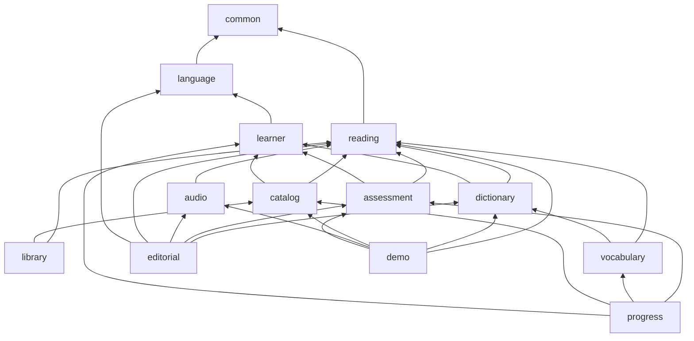

# Arquitectura

## 1. Auditoría de partida (fase 0)

Lesen nace en dos repositorios vacíos, `wasichai/lesen` y `wasichai/lesen-ui`, sobre el ecosistema Wasichai. Se
estudiaron `elearning-backend`, `elearning-frontend`, `wasichai` (1.10.0) y `wasichai-ui` (1.8.2). Lo verificado en el
código, no solo en su documentación:

| Pieza                         | Qué hay de verdad                                                                                                  | Decisión en Lesen                                                                    |
| ----------------------------- | ------------------------------------------------------------------------------------------------------------------ | ------------------------------------------------------------------------------------ |
| Identidad (Wasichai)          | Login con correo y contraseña, JWT HS256 propio (`POST /api/auth/login`), revocación, límite de intentos. Sin OIDC | Se reutiliza tal cual                                                                |
| Permisos (Wasichai)           | Rol → (objeto, acción) en `CurrentUser.requirePermission`; acciones solo predefinidas o declaradas por un objeto   | Dos objetos ancla (`lectura`, `cuaderno`) y los roles `LECTOR` y `EDITOR` (ADR-0002) |
| Usuarios (Wasichai)           | Alta por `POST /api/users` con permiso de administración. **No hay registro público**                              | Alta por quien administra; registro público pedido aguas arriba (§6)                 |
| Persistencia                  | R2DBC `DatabaseClient`, Flyway por módulo con `ModuleMigration`                                                    | Esquema `lesen` con sus migraciones (ADR-0002)                                       |
| Errores                       | `problem+json` desde las excepciones de Wasichai                                                                   | Se reutilizan; lo ajeno es 404                                                       |
| Pruebas                       | `WasichaiIntegrationTest` (Testcontainers o base externa `*_test`), WebTestClient                                  | Se reutiliza, con `model/apply.py` en la primera prueba                              |
| LMS de elearning              | Cursos, ediciones, matrículas, lecciones, «lectura en bloques» (HTML saneado a bloques, calculada al vuelo)        | **No se reutiliza el dominio**: un LMS no es una plataforma de lectura (ADR-0001)    |
| Flujo editorial de elearning  | Borrador → revisión → aprobada → publicada, inmutable, con guardas                                                 | Mismo principio de inmutabilidad; estudio propio (borrador → revisión → publicada)   |
| Cola de trabajos de elearning | `lms.trabajo` con `FOR UPDATE SKIP LOCKED`                                                                         | Se copiará cuando haga falta (generación de audio, fase 3); hoy no hay trabajo largo |
| Interfaz (`@wasichai/core`)   | `WasichaiApp`, registro de módulos, rutas `shell`, `bare` o `public`, i18n por módulo, cliente de API, temas       | Se reutiliza; todas las rutas de Lesen son `bare` con su propio marco (ADR-0006)     |
| Componentes (`@wasichai/ui`)  | Botón, diálogo, campos, tablas, pestañas. Sin popover, hoja inferior, barra de pestañas, toast ni esqueleto        | Diálogo de la librería para las hojas; lo que falta, propio y pedido aguas arriba    |
| Lector de elearning-frontend  | Tipografía Newsreader y Source Sans 3 (OFL), medida de 66ch, preferencias de lectura, barra con tabstop único      | Se toman las fuentes, la idea de la escala y `useRovingToolbar`                      |

## 2. Arquitectura objetivo

Un **monolito modular** (ADR-0001): un despliegue de Spring Boot WebFlux con Wasichai, una base PostgreSQL con el
esquema `lesen` además de los de Wasichai, y una interfaz React servida aparte.

```mermaid
flowchart LR
  ui[lesen-ui<br/>React + @wasichai/core] -- /api --> api
  subgraph api[lesen (Spring Boot WebFlux)]
    wasichai[Wasichai<br/>identidad, permisos, auditoría]
    lesen[Capacidades de Lesen]
  end
  api --> pg[(PostgreSQL<br/>esquemas wasichai y lesen)]
```

## 3. Capacidades y dependencias

Cada capacidad es un paquete de `lesen`. Solo puede importar las de su fila; `ArchitectureTest` lo comprueba y
verifica que el grafo no tiene ciclos.



| Capacidad    | Responsabilidad                                                                                          |
| ------------ | -------------------------------------------------------------------------------------------------------- |
| `common`     | Configuración, `Access` (permisos), cadena de seguridad de lo público, paginación, jsonb                 |
| `language`   | Idiomas de interfaz y de estudio, niveles del MCER                                                       |
| `learner`    | Perfil de aprendizaje (onboarding)                                                                       |
| `reading`    | Contenido: borrador, tokenizador, ensamblado, publicación de versiones inmutables, lectura de versiones  |
| `catalog`    | Temas, colecciones, tarjetas filtradas, ficha, descubrir, recomendación                                  |
| `library`    | Progreso de cada lectura, terminar, marcadores, notas, biblioteca personal y listas propias              |
| `dictionary` | Diccionario curado, consulta en contexto, búsqueda en dos sentidos, historial, favoritas                 |
| `vocabulary` | Cuaderno de vocabulario                                                                                  |
| `audio`      | Narración: activos, voces, tiempos por palabra validados contra el texto, archivos con rangos            |
| `assessment` | Preguntas de comprensión, corrección por reglas, cola de corrección asistida, autoevaluación             |
| `progress`   | Actividad, proyección diaria, panel, resumen semanal, metas, racha semanal, logros, señales de historial |
| `editorial`  | Estudio: borradores, comprobación, revisión, publicación con audio y preguntas, historial, diccionario   |
| `demo`       | Carga del contenido de demostración a través de la publicación real                                      |

`vocabulary` también lleva el repaso FSRS y los encuentros: `library` le avisa al terminar una lectura por
`ReadingCompletionListener`, una interfaz de `reading`, sin depender de ella. Del mismo modo, `library`, `vocabulary` y
`assessment` emiten su actividad por `LearningActivityListener` (en `common`) y `catalog` pide las señales del historial
por `LearnerSignalsSource`; `progress` implementa las dos (ADR-0011) y nadie depende de él. `editorial` (ADR-0012)
escribe solo a través de `reading` (`ReadingPublisher`), `audio`, `assessment` y `dictionary`, y lee las versiones
publicadas para el historial; tampoco depende nadie de él. Los archivos subidos usan `FileStore` de `wasichai-files`
(`common.Media`).

**Modelo de lectura cruzado.** La tarjeta del catálogo une en SQL la versión vigente con el progreso y el marcador de
quien pregunta (tablas de `library`) para no hacer una consulta por tarjeta. Es una lectura consciente del límite;
ninguna capacidad escribe tablas de otra.

## 4. Interfaz

Una sola `WasichaiApp` con un módulo por experiencia (`onboarding`, `discover`, `reader`, `library`, `vocabulary`,
`dictionary`, `profile` y `app` para los textos compartidos). Los módulos no se importan entre sí: comparten solo
`src/shared` (contratos, marco, componentes y claves de ruta). El lector va sin marco y con su propio tema de lectura.
Detalle en `lesen-ui/CLAUDE.md` y `lesen-ui/docs/design-system/lesen/`.

## 5. Seguridad y privacidad

- Cada endpoint propio pasa por `Access`, que pide a Wasichai el permiso sobre el objeto ancla; nunca se mira un rol.
- Lo personal se filtra siempre por organización y usuario del token; una nota, palabra o progreso ajeno da 404.
- Lo público (`/api/lesen/public/**`) es anónimo y de solo lectura, en su propia cadena de seguridad.
- Entradas acotadas (búsqueda ≤ 64, nota ≤ 2000, página ≤ 50, ids ≤ 32); las citas y los contextos guardados salen
  del texto publicado, nunca del cuerpo de la petición.
- Las portadas SVG se sirven con `Content-Security-Policy: default-src 'none'` y `nosniff`.
- El historial de búsquedas guarda solo las últimas 50 de cada persona.

## 6. Riesgos y limitaciones conocidas

| Riesgo                                                 | Mitigación                                                                                       |
| ------------------------------------------------------ | ------------------------------------------------------------------------------------------------ |
| Wasichai no tiene registro público de cuentas          | Alta por administración (`/api/users`) y personas de demostración; registro pedido aguas arriba  |
| Paquetes de Wasichai solo en GitHub Packages           | CI con `PACKAGES_TOKEN` (o acceso del repositorio a los paquetes)                                |
| Diccionario curado a mano: no escala a cualquier texto | Interfaz de proveedor (ADR-0005); la palabra sin entrada se publica igual y se dice honestamente |
| «Palabras desconocidas» necesita saber qué se encontró | `vocabulary_encounter` al terminar cada lectura (fase 4); lo no terminado no cuenta como visto   |
| Corrección asistida depende de un proveedor externo    | Sin clave, autoevaluación con la respuesta modelo; nunca un resultado inventado (ADR-0009)       |
| Contenido de demostración en el classpath              | El estudio publica a la base; audio y portadas subidos van al almacén de `wasichai-files`        |
| Sin generación de voz en el servidor                   | Audio subido con tiempos por palabra (WebVTT, SRT o JSON); proveedor de voz cuando haya uno real |
